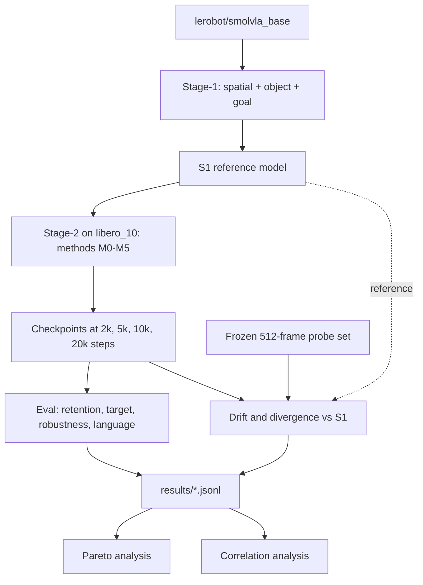

# vla-retain

**Retaining generalization when fine-tuning vision-language-action models: a matched-compute study of retention methods and a divergence test of forgetting.**

[](pyproject.toml)
[](LICENSE)

**Authors:** <Student 1>, <Student 2>, <Student 3>, <Student 4> · Advisor: <Advisor> · San José State University

## TL;DR

Fine-tuning a pretrained vision-language-action model (VLA) on new tasks tends to erode the skills it already had. This repository provides a matched-compute benchmark of retention methods on SmolVLA and LIBERO, together with instrumentation for weight drift, feature drift, and policy divergence. The hypothesis we test is that policy divergence from the reference model, measured on new-task states, predicts forgetting better than weight drift or feature drift. This is a hypothesis under test: no experiments have been run yet, and this repository reports no findings.

## Contents

- [Overview](#overview)
- [What's implemented](#whats-implemented)
- [Methods](#methods)
- [Experimental protocol](#experimental-protocol)
- [Drift and divergence metrics](#drift-and-divergence-metrics)
- [Repository layout](#repository-layout)
- [Installation](#installation)
- [Quickstart](#quickstart)
- [Running on the HPC cluster](#running-on-the-hpc-cluster)
- [Outputs and result schema](#outputs-and-result-schema)
- [Reproducibility](#reproducibility)
- [Design decisions and trade-offs](#design-decisions-and-trade-offs)
- [Results](#results)
- [Limitations and scope](#limitations-and-scope)
- [Roadmap](#roadmap)
- [Citation](#citation)
- [Acknowledgments](#acknowledgments)
- [References](#references)
- [License](#license)

## Overview

We fine-tune `lerobot/smolvla_base` in two stages. Stage-1 produces S1, the reference model for every later comparison, and Stage-2 adapts S1 to new tasks with each retention method. Every checkpoint then passes through the same evaluation and the same drift measurements.



## What's implemented

The table states what has been exercised so far, and is taken from [docs/progress.md](docs/progress.md). `Tested (CPU)` runs LeRobot's real policy code at a tiny size, or real dataset files in a temporary directory. `Tested (real model, CPU)` runs against `lerobot/smolvla_base` itself, and `Written, needs GPU/LIBERO` has not yet run.

| Component | What it does | Status |
| --- | --- | --- |
| Config system and run ids | Dataclass configs from YAML; `run_id` is a short hash of the resolved config | Tested (CPU) |
| Splits and replay sampling | Episode index, seeded replay pools, stateless 80/20 batch sampler | Tested (CPU) |
| Module groups | Maps every parameter to exactly one group | Tested (real model, CPU) |
| M0 expert-only SFT | Trains the action expert with the VLM frozen | Tested (real model, CPU) |
| M1 full SFT | Trains the LM, connector, and expert | Tested (real model, CPU) |
| M2 LoRA | Low-rank adapters on the LM and expert | Tested (real model, CPU) |
| M3 experience replay | M1 with 20% of each batch from a Stage-1 pool | Tested (CPU) |
| M4 weight merging | Interpolates S1 and a fine-tuned model in memory | Tested (CPU) |
| M5 L2-SP | M1 with a proximity penalty to S1 | Tested (CPU) |
| M6 feature anchoring | M1 with a cosine penalty on LM hidden states | Tested (CPU) |
| M7 self-replay training path | Replay from a dataset of S1's rollouts | Tested (CPU) |
| M7 rollout collection | Records S1's successful rollouts as a dataset | Written, needs GPU/LIBERO |
| M8 layer merging | Separate merge weights for early, mid, and late LM layers | Tested (CPU) |
| Training loop, resume, preemption | Method-agnostic loop; exact resume; clean exit on signals | Tested (CPU) |
| Eval runner: sharding, skipping, JSONL, in-memory merges | Task-level shards; finished work is skipped | Tested (CPU) |
| Rollouts | Parallel LIBERO rollouts with fixed init states and seed | Written, needs GPU/LIBERO |
| Perturbations: sampling and model edits | Deterministic per-episode camera, lighting, background, and noise edits | Tested (CPU) |
| Perturbations in the simulator | Applies those edits to a live robosuite model | Written, needs GPU/LIBERO |
| Language tests: swap plan | Assigns each goal task a different instruction | Tested (CPU) |
| Language tests in the simulator | Runs swapped instructions, scored on the swapped goal | Written, needs GPU/LIBERO |
| Probes: selection, freezing, round trip | Seeded frame choice; refuses to overwrite a frozen file | Tested (CPU) |
| Probe building from `lerobot/libero` | Reads the chosen frames from the dataset | Written, needs GPU/LIBERO |
| Weight drift, CKA | Relative L2 per module group; 1 - linear CKA per LM layer | Tested (CPU) |
| Divergence metrics | Shared-noise action distance, velocity distance, action MMD | Tested (real model, CPU) |
| Pareto and correlation analysis | Matched-steps and matched-hours views; Spearman, LOMO R², partial correlation | Tested (CPU) |
| Figure generation | Figures and Table 1 from JSONL; absent values print as missing | Tested (CPU) |
| SLURM launch layer | One-command launches with `--dry-run`, checked against a fake `sbatch` | Tested (CPU) |
| Gate checks | PASS, FAIL, or MISSING for Gates 1 and 2 | Tested (CPU) |

`make test` collects 249 tests. The 11 in `tests/test_real_model.py` are skipped automatically if `lerobot/smolvla_base` is not cached.

## Methods

All methods start from S1 and share the same data, schedule, and evaluation. Learning rates and other settings are chosen under the same budget of 3 trials per method.

| ID | Method | Core idea | What trains | Extra cost |
| --- | --- | --- | --- | --- |
| M0 | Expert-only SFT | Keep the VLM fixed, so language and vision features cannot drift | Action expert and projections (99.9M parameters) | None |
| M1 | Full SFT | The baseline against which forgetting is measured | LM, connector, and expert (306.5M parameters); vision encoder frozen | None |
| M2 | LoRA | Confine the change to a low-rank update (r=16, alpha=32, dropout 0.05) | Adapters on attention q/k/v/o and MLP linears of the LM and expert (7.8M parameters) | Adapter bookkeeping |
| M3 | Experience replay (2% / 10%) | Rehearse old tasks: 80% target and 20% replay in each batch | Same as M1 | Pool of 26 or 131 Stage-1 episodes; storage and data access |
| M4 | Weight merging (global and per-module α) | Interpolate between S1 and the fine-tuned model after training | Nothing new: reuses M1's checkpoint | Validation rollouts per α (11 global, 16 per-module) |
| M5 | L2-SP proximity | Penalize distance from S1 during training | Same as M1 | One penalty term per step; a copy of S1's trainable weights |

Under M1, LeRobot always keeps the last LM layer, the LM norm, and `lm_head` frozen, and we follow the code. Parameter counts were measured on `lerobot/smolvla_base`; see [docs/progress.md](docs/progress.md).

**Optional (disabled by default).** These are built and tested at the same interface, and run only with `--allow-disabled` or an explicit sweep.

| ID | Method | Core idea | What trains | Extra cost |
| --- | --- | --- | --- | --- |
| M6 | Feature anchoring | Cosine distance to frozen S1 hidden states on the LM's mid and last layers (λ in {0.1, 1}) | Same as M1 | Two more prefix passes per step |
| M7 | Self-replay | Replay S1's own successful rollouts instead of demonstrations | Same as M1 | Rollouts to build the pool |
| M8 | Layer-group merging | M4 with separate α for early, mid, and late LM layers | Nothing new: reuses M1's checkpoint | Validation rollouts per α (27 entries) |

**Weight merging.** A merge is computed in memory at eval time and never written to disk.

$$
\theta(\alpha) = (1 - \alpha)\,\theta_{S1} + \alpha\,\theta_{FT}
$$

Merging is in the study because it needs no retraining and adds no training-time cost, which makes it the natural low-compute baseline for retention.

**L2-SP.** The penalty is averaged over the trainable parameters $\mathcal{T}$.

$$
L = L_{\text{action}} + \lambda \cdot \frac{1}{|\mathcal{T}|} \sum_{i \in \mathcal{T}} \left(\theta_i - \theta_{S1,i}\right)^2
$$

L2-SP is in the study because it acts directly on weight drift, so it directly tests whether limiting weight drift is enough to limit forgetting.

### The method interface

Every method implements the same three calls, and the training loop never branches on a method's name. A test reads the loop's source to keep it that way. Replay is driven by `data.*` config fields, so the data layer needs no knowledge of methods either.

```python
class Method:
    def build_model(self, s1_ckpt, cfg): ...          # load S1 and set the trainable parameters
    def extra_loss(self, policy, batch, step): ...    # add a term to the action loss, or return None
    def post_train(self, ckpt_dir, cfg): ...          # any work after the final checkpoint
```

A method is selected by a YAML overlay on `configs/base.yaml`, which also lists its tuning trials.

```yaml
# configs/methods/l2sp.yaml
method:
  name: l2sp
  id: M5
  params: {lam: 1.0e-1}
model: {train_expert_only: false}
train: {lr: 3.0e-5}
tuning:
  - {method.params.lam: 1.0e-2}
  - {method.params.lam: 1.0e-1}
  - {method.params.lam: 1.0}
```

Before training starts, each method checks its trainable set against what it claims. A config meant to train the LM stops with an error if the LM has no trainable parameters.

## Experimental protocol

Episode counts below come from `splits/episodes.json`, for the pinned revision of `lerobot/libero`. Task and rollout counts come from `configs/eval/`.

| Split | Purpose | Tasks | Episodes | Notes |
| --- | --- | --- | --- | --- |
| Stage-1 train | Produces S1 | 30 (`libero_spatial`, `libero_object`, `libero_goal`) | 1,314 demos | 40k steps |
| Stage-2 target | Adaptation | 10 (`libero_10`) | 379 demos | 20k steps |
| Replay pool | M3 | Spread across Stage-1 tasks | 26 (2%) or 131 (10%) demos | Fixed by seed; 2% has fewer episodes than tasks |
| Retention eval | Old skills | 30 | 30 × 10 = 300 rollouts | Init states 0-9 |
| Target eval | New skills | 10 | 10 × 20 = 200 rollouts | Init states 0-19 |
| Robustness eval | Old skills under perturbation | 10 fixed | 10 × 4 axes × 5 = 200 rollouts | Camera, lighting, background, sensor noise |
| Language eval | Language conditioning | 10 (`libero_goal`) | 10 × 5 = 50 rollouts for the swap | Plain `libero_goal` success is read from retention |
| Validation | Selection only | 40 | 40 × 5 = 200 rollouts | Init states 40-44, disjoint from all of the above |

- **Training budget.** AdamW with a cosine schedule, 1k warmup steps, and batch 32. Stage-1 runs 40k steps, and Stage-2 runs 20k.
- **Checkpoints.** We save at 2k, 5k, 10k, and 20k steps, which gives each method a curve on the Pareto plot rather than one point.
- **Seeds.** Final runs use 3 seeds (1, 2, 3). Tuning uses seed 0, so selected configurations are not scored on the seed that selected them.
- **Equal tuning budget.** Each method gets 3 trials, selected on validation by mean(target SR, retention SR). Learning rates are {1e-5, 3e-5, 1e-4} for M0 and M1, and {1e-4, 3e-4, 1e-3} for M2.
- **Two views of matched compute.** One panel compares methods at fixed training steps. The other compares them at a fixed GPU-hour budget, counting a merge's validation sweep toward its compute.
- **Statistics.** Task-level rates carry Wilson 95% intervals, and paired comparisons use a bootstrap over tasks. Correlations use a bootstrap over runs, because checkpoints of one run are not independent.

All evaluation uses fixed LIBERO init states and a fixed eval seed, so every method faces the same episodes. Retention is reported relative to S1, task by task.

## Drift and divergence metrics

All metrics are measured relative to S1, on a frozen set of 512 frames: 256 from `libero_10` demos and 256 from Stage-1 demos.

| Metric | Measures | Computed on |
| --- | --- | --- |
| Relative weight L2 | $\lVert\theta - \theta_{S1}\rVert_2 / \lVert\theta_{S1}\rVert_2$ per module group (vision, connector, LM early/mid/late, expert) | Weights only |
| 1 - linear CKA | Change in the representation at each LM layer | New-task and old-task probes, separately |
| Shared-noise action-chunk distance | How far sampled actions move, given the same observation and the same noise | New-task and old-task probes, separately |
| Velocity-field distance | $\mathbb{E}\lVert v_\theta - v_{S1}\rVert^2$ over random $t$ and shared noisy actions | New-task and old-task probes, separately |
| Action MMD | Distribution distance between 16 action samples per state (RBF kernel, median-heuristic bandwidth) | New-task and old-task probes, separately |

The split between probe halves is the core of the test. [RL's Razor](https://arxiv.org/abs/2509.04259) argues that forgetting follows how far a learner's policy moves from the original on the states it visits while learning, which here are the new-task states. Measuring every metric on both halves lets us ask whether divergence on new-task states carries predictive signal that old-task divergence and parameter-space drift do not.

## Repository layout

```text
vla-retain/
├── configs/
│   ├── base.yaml              # Settings shared by every Stage-2 run
│   ├── stage1.yaml            # Overlay for Stage-1
│   ├── methods/               # One file per method, with its tuning trials
│   └── eval/                  # One file per eval set
├── src/vlaretain/
│   ├── config.py              # Dataclass configs and run_id hashing
│   ├── data/                  # Splits, batch mixing, probes, self-replay
│   ├── models/                # Checkpoint loading, velocity, hidden states, module groups
│   ├── methods/               # The Method interface and M0-M8
│   ├── train/loop.py          # Training loop, resume, preemption
│   ├── eval/                  # Rollouts, eval sets, perturbations, runner, statistics
│   ├── drift/                 # Weight drift, CKA, divergence
│   ├── analysis/              # Pareto, correlations, figures, synthetic demo data
│   └── utils/                 # Seeding, JSONL, GPU-hour accounting, signals
├── scripts/
│   ├── smoke.py               # Fetch artifacts; time rollouts at 1/4/8 envs
│   ├── train.py               # Train Stage-1 or one method
│   ├── eval.py                # Evaluate a checkpoint or a merge
│   ├── drift.py               # Measure drift and divergence
│   ├── merge_sweep.py         # Validation sweep over α, then full eval
│   ├── check_gate1.py         # Gate 1: S1 quality, and forgetting to study
│   ├── check_gate2.py         # Gate 2: rho of new-state divergence vs forgetting
│   ├── plan_finals.py         # Pick each method's best trial
│   └── aggregate.py           # Rebuild figures, tables, and the README results block
├── slurm/
│   ├── common.sh              # All cluster settings, TODO values at the top
│   ├── train.sbatch           # One link of a training chain, with signal forwarding
│   ├── eval_array.sbatch      # One shard of an eval
│   ├── drift.sbatch           # A single GPU job
│   ├── smoke.sbatch           # The smoke test
│   ├── chain.sh               # Queue a resumable training chain by hand
│   └── launch_*.sh            # Stage-1, pilots, tuning, finals, evals
├── splits/episodes.json       # Episode index of the pinned dataset revision
├── probes/                    # The frozen probe set, built on the cluster
├── examples/synthetic/        # Fabricated results for the demo figures
├── results/                   # JSONL results; checkpoints go to scratch
├── tests/                     # CPU tests, including tests of this README
└── docs/
    ├── lerobot_notes.md       # LeRobot APIs, with file paths and line numbers
    ├── decisions.md           # One line per decision, with date and reason
    ├── hpc.md                 # Compute and storage notes
    ├── progress.md            # What is tested, what is not, known risks
    └── RUNBOOK.md             # Exact commands from login to figures
```

## Installation

We pin LeRobot to `v0.6.1`, which requires Python 3.12.

**Local, for development and tests (macOS or Linux, CPU).** This omits LIBERO, which does not install on macOS. Simulator code is simply not exercised.

```bash
python3.12 -m venv .venv
source .venv/bin/activate
pip install -e ".[dev]"
```

**Cluster (Linux, GPU, with LIBERO).** LIBERO requires Linux. On headless nodes it also needs `MUJOCO_GL=egl`, which `slurm/common.sh` sets for every job.

```bash
conda create -y -n vla-retain python=3.12
conda activate vla-retain
pip install -e ".[dev,libero]"
export MUJOCO_GL=egl
```

## Quickstart

This section needs no GPU. Run the tests:

```bash
make test
```

Inspect one method's resolved config and run id, without training:

```bash
python scripts/train.py --config configs/base.yaml --config configs/methods/lora.yaml --trial 1 --set s1_run=example --dry-run
```

Build the figures from the bundled synthetic example. They go to `paper_assets/demo/`, and each title says "synthetic data". The example's rates are independent random draws, so no pattern in those figures means anything.

```bash
make figures-demo
```

## Running on the HPC cluster

Evaluation dominates this project's compute, so step 4 matters more than it may seem. Each step below is written for a fresh login; [docs/RUNBOOK.md](docs/RUNBOOK.md) has the full detail.

**1. Log in and set up the environment.** Follow the cluster block under [Installation](#installation).

**2. Fill in the TODO variables in `slurm/common.sh`.** Everything specific to the cluster lives in this one place.

| Variable | Meaning |
| --- | --- |
| `VR_PARTITION` | SLURM partition |
| `VR_ACCOUNT` | SLURM account |
| `VR_GPU_TYPE` | GPU type in `--gres`, such as `h100` or `a100` |
| `VR_SCRATCH` | Scratch path for checkpoints, videos, and the Hugging Face cache |
| `VR_CONDA_ENV` | Name of the conda environment |

Then fetch models, data, and LIBERO's assets from the login node. LIBERO's first import asks a question on stdin, which a batch job cannot answer.

```bash
source slurm/common.sh
python scripts/smoke.py --download-only
```

**3. Check job limits.** We assume 48-hour limits and a 5-minute preemption warning. If either differs, change `VR_TIME` and `VR_EVAL_TIME` in `slurm/common.sh`.

```bash
scontrol show partition
```

**4. Run the smoke test and read its timing.** It prints seconds per episode at 1, 4, and 8 parallel environments, then hours per checkpoint. A full eval is 750 rollouts, and every later phase multiplies that cost, so this number sets the eval budget and `VR_N_ENVS` should take the fastest row.

```bash
source slurm/common.sh
mkdir -p "$VR_LOG_DIR"
sbatch --partition="$VR_PARTITION" --account="$VR_ACCOUNT" --gres="gpu:$VR_GPU_TYPE:1" --cpus-per-task="$VR_CPUS" --mem="$VR_MEM" --output="$VR_LOG_DIR/smoke-%j.out" slurm/smoke.sbatch
```

The table counts rollouts per phase, from the configs. Multiply by the smoke test's seconds per episode to estimate GPU-hours before committing to a phase.

| Phase | Rollouts |
| --- | --- |
| S1 eval | 950 |
| Tuning: 15 trials, validation at 2 steps | 6,000 |
| Merge sweeps: 11 + 16 α settings on validation | 5,400 |
| Finals: 5 methods × 3 seeds × 4 checkpoints | 45,000 |
| Finals: 2 merge grids × 3 seeds | 4,500 |

**5. Train Stage-1.** This freezes the probe set, trains S1, and queues S1's evaluation automatically.

```bash
bash slurm/launch_stage1.sh
```

**6. Run the pilots, and check Gate 1.** The pilots are M1 and M3 with the 2% pool, one seed each. They are tuning trials, so step 7 reuses them.

```bash
bash slurm/launch_pilots.sh
python scripts/check_gate1.py
```

The output below is an example of the format only. Its values are placeholders and are not results.

```text
runs: S1=example00 M1=example01 M3=example02 step=20000
PASS    S1 averages >= 80% across Stage-1 suites: S1 mean SR = 00.0%
FAIL    M1 forgets >= 10 points: M1 forgetting = 0.0 points
        Suggested fix: M1 barely forgets, so retention methods have little to show. ...
PASS    M3 forgets less than M1: M3 forgetting = 0.0 points
GATE 1: FAIL
```

**7. Run tuning, merge sweeps, and drift, then check Gate 2.** This queues all 15 trials, with validation evals and drift. Once they finish, a small job starts the merge sweeps on the best M1 trial.

```bash
bash slurm/launch_tuning.sh
python scripts/check_gate2.py
```

**8. Plan and launch the finals.** The planner picks each method's best trial on validation, then the launcher queues 3 seeds with full evals and drift.

```bash
python scripts/plan_finals.py --dry-run
bash slurm/launch_finals.sh
```

**9. Build the figures and update this README.** Every number comes from the JSONL files, and absent results show as `missing`.

```bash
python scripts/aggregate.py --results results --out paper_assets
python scripts/aggregate.py --results results --out paper_assets --update-readme
```

### Monitoring and recovery

Every launch script accepts `--dry-run`, which prints the `sbatch` commands and submits nothing. It works before `slurm/common.sh` is filled in.

```bash
bash slurm/launch_stage1.sh --dry-run
bash slurm/launch_pilots.sh --dry-run
bash slurm/launch_tuning.sh --dry-run
bash slurm/launch_finals.sh --dry-run
bash slurm/launch_evals.sh --dry-run --run-id example --steps 20000
bash slurm/chain.sh --dry-run --config configs/base.yaml --config configs/stage1.yaml
```

What each script queues:

| Script | Queues | Depends on |
| --- | --- | --- |
| `slurm/launch_stage1.sh` | Probe build, S1 training chain, S1 eval array | Nothing |
| `slurm/launch_pilots.sh` | M1 and M3 chains, evals, validation, drift | S1 on disk |
| `slurm/launch_tuning.sh` | 15 trial chains, validation, drift, then merge sweeps | S1 on disk |
| `slurm/launch_finals.sh` | 3-seed chains, full evals, drift, merges | `scripts/plan_finals.py` |
| `slurm/launch_evals.sh` | One eval array, by hand | A finished checkpoint |
| `slurm/chain.sh` | One training chain, by hand | Nothing |

Watch jobs and logs:

```bash
squeue -u "$USER"
source slurm/common.sh
tail -f "$VR_LOG_DIR"/vr-s1-*.out
```

- **Auto-resume.** Training saves every 1k steps and resumes from `checkpoints/latest`. A run writes a `DONE` marker when it finishes, and launch scripts skip finished runs.
- **Preemption.** `train.sbatch` asks SLURM for a signal 300 s before the limit, and forwards it, so Python saves and exits cleanly. `chain.sh` queues the next links with `--dependency=afterany`, and each link exits at once if `DONE` exists.
- **Rerunning evals.** Results are keyed by (run_id, step, alpha_spec, eval_set, task_id). Finished work is skipped, so rerunning any eval command is safe, and fills only the gaps.
- **Cleaning scratch.** The resume state of a finished run can go, while milestone checkpoints stay. [docs/RUNBOOK.md](docs/RUNBOOK.md#cleaning-scratch) has the commands.

## Outputs and result schema

| Output | Location |
| --- | --- |
| Checkpoints and run metadata | `$VR_SCRATCH/vla-retain/runs/<run_id>/` |
| Results | `results/*.jsonl`, append-only |
| Episode-0 videos, per task | `$VR_SCRATCH/vla-retain/videos/` |
| SLURM logs | `$VR_SCRATCH/vla-retain/logs/` |
| Figures and tables | `paper_assets/` |
| Demo figures from synthetic data | `paper_assets/demo/` |

Each eval row holds these fields.

| Field | Meaning |
| --- | --- |
| `run_id`, `method`, `seed` | What ran |
| `step`, `alpha_spec` | Which checkpoint, and which merge (`none` if not merged) |
| `eval_set`, `task_id` | For example `retention`, `libero_goal/03` |
| `n_episodes`, `n_success`, `sr` | Counts and success rate |
| `wilson_lo`, `wilson_hi` | Wilson 95% interval |
| `gpu_hours_train`, `gpu_hours_eval` | Compute used |
| `git_sha`, `lerobot_sha`, `timestamp` | Provenance |

Drift rows use `eval_set: drift`, and also carry `probe_split`, `module`, `layer`, `metric`, and `value`.

The line below is an example of the format, with deliberately fake values.

```json
{"run_id": "example", "method": "example", "seed": 0, "step": 0, "alpha_spec": "none", "eval_set": "retention", "task_id": "libero_spatial/00", "n_episodes": 0, "n_success": 0, "sr": 0.0, "wilson_lo": 0.0, "wilson_hi": 0.0, "gpu_hours_train": 0.0, "gpu_hours_eval": 0.0, "git_sha": "example", "lerobot_sha": "example", "timestamp": "1970-01-01T00:00:00+00:00"}
```

## Reproducibility

- **`run_meta.json`.** Every run records its git SHA, LeRobot SHA, a hash of the installed packages, GPU type, seed, and resolved config.
- **`run_id`.** It is a 10-character hash of the resolved config. Fields that do not change a run's outputs, such as paths and worker counts, are excluded, so the same experiment keeps its id across machines.
- **Pinned versions.** LeRobot is pinned to commit `7e241bd630a3719a56157a497ce5d08f244784f1` (`v0.6.1`) in [pyproject.toml](pyproject.toml). `lerobot/libero` and `lerobot/smolvla_base` are pinned to Hub revisions in [configs/base.yaml](configs/base.yaml).
- **Evaluation.** Every eval uses fixed LIBERO init states and a fixed eval seed. Perturbations are drawn from the identity of the episode, so every method sees the same ones.
- **Training randomness.** Batches and per-step noise are pure functions of (seed, step), which is why a resumed run reproduces the same batches. A CPU test checks that resuming at step 10 reproduces the step-20 loss.

## Design decisions and trade-offs

The full log, with dates and reasons, is in [docs/decisions.md](docs/decisions.md).

- **We wrap LeRobot rather than fork it.** A subclass of `LiberoEnv` and a few helper functions cover everything we need, so upgrades stay a matter of changing the pin. Each API we rely on is recorded with its file path and line number in [docs/lerobot_notes.md](docs/lerobot_notes.md).
- **Merges stay in memory.** A full checkpoint is about 1.8 GB, and the sweeps visit up to 27 α settings per run. Merging at load time needs no extra storage, and leaves only source checkpoints to manage.
- **The vision encoder stays frozen.** The study concerns forgetting in the language model and the action expert, and the frozen encoder keeps the method comparison focused there. This also removes 86M parameters from training.
- **`libero_goal` serves as the language test.** All 10 of its tasks share one scene, and differ in their goal and instruction. A policy given another task's instruction must rely on language to succeed, and the swapped goal can be checked directly.
- **Evaluation parallelism dominates cost.** Each checkpoint costs 750 rollouts, and sweeps and tuning multiply that. We therefore measure throughput first, with the smoke test, and shard evals by task, so preemption loses at most one task.
- **We use our own perturbation wrapper instead of LIBERO-Plus.** Installing LIBERO-Plus replaces vanilla LIBERO, so robustness evals would need a separate environment, along with system packages we cannot assume on the cluster. Our wrapper covers the four axes we need, at the cost of not matching LIBERO-Plus's task variants.
- **Weights are upcast to float32.** The base checkpoint stores most weights in bfloat16, where updates at our learning rates round to nothing. A test demonstrates this, and it costs extra memory.

## Results

<!-- RESULTS:START -->
Experiments are in progress. This section is generated automatically from results/ by scripts/aggregate.py --update-readme.
<!-- RESULTS:END -->

## Limitations and scope

- **Simulation only.** All results will come from LIBERO, with no real-robot evaluation.
- **One base model.** We study `lerobot/smolvla_base`, so conclusions may not transfer to other VLAs or architectures.
- **Greedy choices of eval budget.** Episode counts and validation sizes are set by compute limits, so small differences between methods may not be resolvable.
- **Divergence proxies.** True KL divergence is not tractable for flow-matching policies, so we use velocity distance, shared-noise action distance, and MMD as proxies.
- **LIBERO-Plus subset.** Our four perturbation axes only approximate a subset of LIBERO-Plus's seven dimensions, and our magnitudes are our own choices.

## Roadmap

- [ ] Stage-1: train and evaluate S1
- [ ] Gate 1: pilots confirm forgetting, and that replay reduces it
- [ ] Tuning: 3 trials per method, plus merge sweeps
- [ ] Gate 2: new-state divergence against forgetting
- [ ] Finals: 3 seeds per method
- [ ] Paper

## Citation

To be updated on publication.

```bibtex
@misc{vlaretain2027,
  title  = {Retaining Generalization when Fine-Tuning Vision-Language-Action Models: A Matched-Compute Study of Retention Methods and a Divergence Test of Forgetting},
  author = {<Student 1> and <Student 2> and <Student 3> and <Student 4> and <Advisor>},
  year   = {2027},
  note   = {To be updated on publication}
}
```

## Acknowledgments

We thank the SJSU College of Engineering HPC for compute. This work builds on [LeRobot](https://github.com/huggingface/lerobot), [SmolVLA](https://arxiv.org/abs/2506.01844), [LIBERO](https://github.com/Lifelong-Robot-Learning/LIBERO), and [LIBERO-Plus](https://github.com/sylvestf/LIBERO-plus), and we are grateful to their authors.

## References

- RL's Razor: Why Online Reinforcement Learning Forgets Less. [arXiv:2509.04259](https://arxiv.org/abs/2509.04259)
- Knowledge Insulating Vision-Language-Action Models: Train Fast, Run Fast, Generalize Better. [arXiv:2505.23705](https://arxiv.org/abs/2505.23705)
- RETAIN, from Robust Finetuning of Vision-Language-Action Robot Policies via Parameter Merging. [arXiv:2512.08333](https://arxiv.org/abs/2512.08333)
- LIBERO-Plus: In-depth Robustness Analysis of Vision-Language-Action Models. [arXiv:2510.13626](https://arxiv.org/abs/2510.13626)
- LIBERO-PRO: Towards Robust and Fair Evaluation of Vision-Language-Action Models Beyond Memorization. [arXiv:2510.03827](https://arxiv.org/abs/2510.03827)
- SmolVLA: A Vision-Language-Action Model for Affordable and Efficient Robotics. [arXiv:2506.01844](https://arxiv.org/abs/2506.01844)
- LIBERO: Benchmarking Knowledge Transfer for Lifelong Robot Learning. [arXiv:2306.03310](https://arxiv.org/abs/2306.03310)
- Pretrained Vision-Language-Action Models are Surprisingly Resistant to Forgetting in Continual Learning. [arXiv:2603.03818](https://arxiv.org/abs/2603.03818)

## License

This project is released under the [MIT License](LICENSE).
